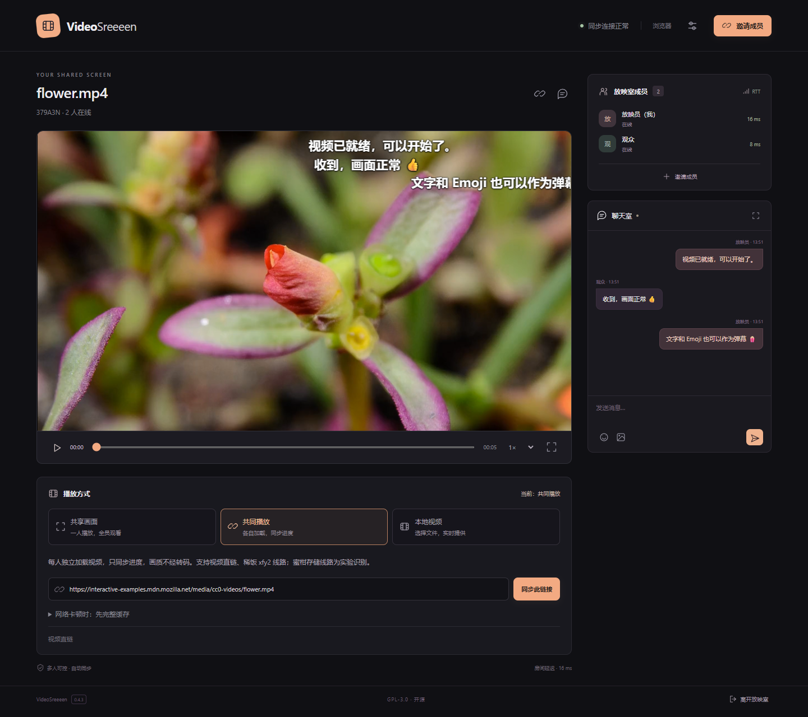
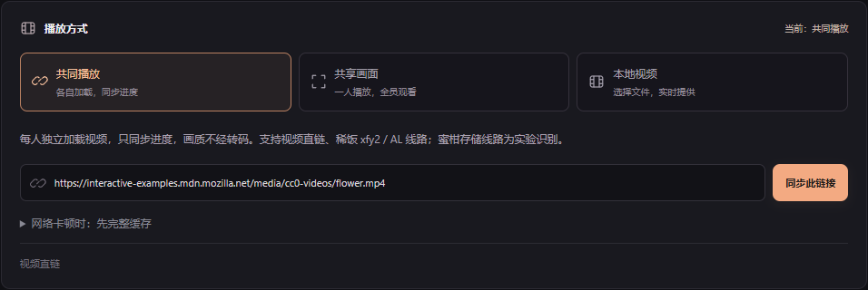
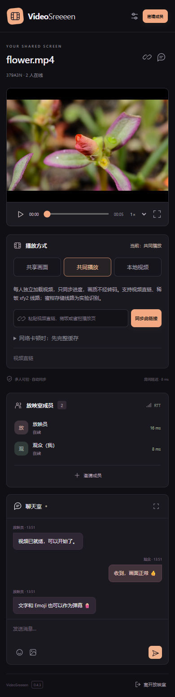

# VideoSreeeen

无需浏览器扩展的多人观影程序。支持 **Windows、Android 和浏览器**，提供共同播放、实时画面共享、本地视频与房间聊天。

**优先共同播放**：每位成员独立加载视频，房间同步暂停、进度与倍速，保留原始画质。共享画面和本地视频实时提供继续作为可选方式。

**[打开网页版](https://videosreeeen.pages.dev)** · [Windows 安装版](https://github.com/BorderArea01/VideoSreeeen/releases/latest/download/VideoSreeeen-Setup.exe) · [Android APK](https://github.com/BorderArea01/VideoSreeeen/releases/latest/download/VideoSreeeen-Android.apk) · [全部发行版](https://github.com/BorderArea01/VideoSreeeen/releases) · [反馈问题](https://github.com/BorderArea01/VideoSreeeen/issues/new/choose)

> **下载状态 · 2026-10-19：** v0.4.3 安装包已发布，但 GitHub Release 页面匿名访问仍返回 404，公共下载与在线更新尚未恢复。当前可先使用网页版，详情见 [公开访问记录](docs/github-access.md)。



_当前版本的本地双端实播截图，使用 MDN CC0 示例视频；昵称和消息为演示内容，成员与 RTT 来自实际连接。_

## 开始观看

1. 打开[网页版](https://videosreeeen.pages.dev)或客户端，填写昵称并创建房间，无需注册。
2. 将自动生成的**完整邀请链接**发给朋友，对方填写昵称即可加入。
3. 播放器下方默认选中**共同播放**，粘贴视频链接开始观看；需要时手动选择共享画面或本地视频。

普通使用无需填写服务器。自建服务地址收在“设置与帮助 → 连接设置”；邀请链接会自动选择对应服务器。邀请包含入房凭证，请只发给预期成员，六位房间号不能单独作为完整邀请使用。

## 选择播放方式

| 方式         | 适合什么情况                           | 视频如何到达观众                                                        | 播放控制                                           |
| ------------ | -------------------------------------- | ----------------------------------------------------------------------- | -------------------------------------------------- |
| **共同播放** | 可播放的视频直链、已适配的原站         | 各人独立加载视频，房间只同步状态，画质不经重新编码                      | 成员均可暂停、拖动和调倍速，冲突由房间服务统一处理 |
| **共享画面** | 希望由一人提供画面，或共同播放暂不兼容 | 一位成员提供标签页、屏幕或 Windows 客户端原站的音视频，其他成员接收画面 | 在提供方的原播放器操作；观众可调本机声音和全屏     |
| **本地视频** | 想播放自己电脑或手机上的文件           | 选取文件后实时提供，无需先上传整部视频；提供者保持在线                  | 房间同步暂停、进度与倍速                           |



切换方式标签只切换输入面板，不会替换正在播放的视频；提交新视频才会切换房间媒体。

- **共享画面怎么开始？** 在电脑浏览器打开并播放原站，回到房间点“共享视频标签页”，在浏览器选择窗口中选中该标签页并开启音频。仅点击“打开原站”不会开始共享。Windows 客户端也可在内置原站播放器中选择“共享原站画面”。
- **共同播放怎么开始？** 粘贴可播放的 MP4 / WebM / HLS 直链，或受支持的原站页面。页面识别后先检查提供者能否加载首帧，成功才替换房间视频；失败或取消保留当前影片。
- **本地文件怎么选？** 点“本地视频 → 打开视频文件”。推荐 H.264 / AAC 的 MP4，其他编码取决于设备支持。

## 房间功能

- **文字、Emoji 与图片聊天**：聊天室固定高度、内部滚动，查看历史时不被新消息强行拉到底部；侧栏可隐藏和拖拽。
- **粘贴截图**：输入框支持直接粘贴剪贴板图片，保留文字草稿。GIF / PNG / JPEG / WebP 单张最多 **20 MiB**，可查看原图；单房间图片总量限 64 MiB。
- **实时聊天弹幕**：新文字和 Emoji 可以飘过视频，支持关闭；重连不重放历史消息。图片留在聊天室，弹幕不会烧录进共享画面。
- **成员延迟**：显示实际测得的服务器 RTT，过期显示未知。这是到房间服务的往返延迟，**不是画面延迟**。
- **下一集**：共同播放可读取原站明确提供的下一集地址，统一为房间换片；喜番为同番同线路，蜜柑为客户端原站配置，B 站为同一 BV 的下一分 P。末集或识别失败不影响当前视频。
- **手动共同缓存**：收在共同播放分支，默认关闭。适合可下载的视频源，不能用于实时画面。

<details>
<summary>手机浏览器界面</summary>



截图为桌面浏览器的 390px 视口，展示响应式布局，不代表 Android 或 iOS 真机验收。

</details>

## 原站兼容情况

以下是 **0.4.3 与后续网页修订的实际验证范围**，不是对站点全部线路和视频的保证。2026-10-20 新增 AL 识别属于网页更新，本轮没有发布新版客户端安装包。

| 视频来源                       | 纯浏览器共同播放                                     | Windows 客户端共同播放                               |
| ------------------------------ | ---------------------------------------------------- | ---------------------------------------------------- |
| MP4 / WebM / HLS 视频直链      | 支持；需要源站允许访问、跨域和设备支持解码           | 支持；仍受源站访问权限与编码限制                     |
| 喜番／稀饭 `next.xifanacg.com` | xfy2 / AL 线路已实播验证 1080p、音频、同步和下一集   | xfy2 已验证；AL 本轮仅验证浏览器共同播放             |
| 蜜柑 `mgnacg.com`              | 存储线路为实验识别，存在原站 403 / 520，不能保证可用 | 已实播验证原站 1080p、音频、双端同步和下一集         |
| B 站 `bilibili.com/video`      | 暂不能把页面当作通用直链播放，建议共享画面           | 已实播验证游客 360p 原站同步；登录后高清仍需单独验收 |

原站仍可能因线路调整、登录、临时链接、防盗链或网络条件失效。识别到 URL 不等于能播放，具体证据见 [原站验证](docs/verification-native-sites.md)、[共同播放与聊天验证](docs/verification-chat-playback.md)、[AL 新番线路验证](docs/verification-xifan-al.md)。

**移动设备兼容仍需分别验证。** 已知 AL 样片采用 HEVC/H.265，电脑实播通过不代表手机也能解码。手机播放失败可使用本机重试并复制诊断；当前现场问题与验证边界见 [手机播放记录](docs/verification-mobile-source.md)。

2026-10-20 对两个 B 站链接的正常游客请求复验：播放接口实际返回 360p / 480p 轨道，播放器实际解码为 360p；清晰度列表虽包含 1080p，但未返回对应视频轨道，尚未实现游客 1080p 共同播放。复验方法见 [共同播放优先与画质验证](docs/verification-common-priority.md)。

**B 站登录态只留在本机。** 客户端通过官方页面登录并复用自己的原站会话，不读取系统浏览器 Cookie、不把 Cookie 上传服务器或交给房间成员。共同播放时每个人使用自己的访问权限；希望由一人提供画面时，选择共享画面。登录、付费和 DRM 限制仍由原站决定。

## 客户端与更新

| 平台                | 入口                                                                                                                                                                    | 当前边界                                                         |
| ------------------- | ----------------------------------------------------------------------------------------------------------------------------------------------------------------------- | ---------------------------------------------------------------- |
| Windows x64         | [安装版](https://github.com/BorderArea01/VideoSreeeen/releases/latest/download/VideoSreeeen-Setup.exe)／[便携版](https://github.com/BorderArea01/VideoSreeeen/releases) | 安装版支持应用内下载并重启更新，已做实际成品验证                 |
| Android 8.0+        | [APK](https://github.com/BorderArea01/VideoSreeeen/releases/latest/download/VideoSreeeen-Android.apk)                                                                   | 应用内下载后由系统确认覆盖安装；已生成发行包，设备实测待补齐     |
| 浏览器              | [直接打开](https://videosreeeen.pages.dev)                                                                                                                              | 无需安装；标签页共享由电脑浏览器发起，移动端按实际浏览器能力使用 |
| iPhone / iPad / Mac | [浏览器入口](https://videosreeeen.pages.dev)                                                                                                                            | 不开发苹果原生客户端；Safari / iOS 实播、后台与锁屏仍待验收      |

更新和下载目前受上方 GitHub 公开访问问题影响。Android 正式版保持固定包名和签名，可覆盖同签名旧版；早期 debug APK 与正式版签名不同，不能直接覆盖。发布步骤、签名与校验和说明见 [更新与分发](docs/updates.md)。

## 使用前了解

**实时共享有缓冲与画质损耗。** 默认经独立 WebSocket 视频通道转发，不依赖远程 WebRTC 直连成功。提供者可选流畅、高清或高画质，采集目标最高 1080p / 30fps；实际效果取决于设备与网络，接收端约 2.5 秒起步缓冲。目前最多 4 位观众接收，提供者保持在线。

**公共服务有免费额度限制。** 当前使用 Cloudflare Workers Free + Durable Objects，不启用收费 TURN，也不自动升级付费。额度耗尽或网络不可达时可能无法使用；开源用户可自行部署。公共部署关闭原站视频文件代理，视频直链共同播放仍从原 CDN 加载。

<details>
<summary>共同缓存适合什么情况？有哪些限制？</summary>

当大家能取得视频源，但边播边看容易卡顿时，可以展开“共同播放 → 网络卡顿时：先完整缓存”。每人先完整下载并校验内容一致，全员就绪后播放。它不能提升原画质，也不能修复实时画面共享的卡顿。

| 平台              | 完整缓存范围                                                                                                                              |
| ----------------- | ----------------------------------------------------------------------------------------------------------------------------------------- |
| Windows / Android | 完整文件、分离音视频和有限的非加密 HLS；默认最多 4 GiB，预留 256 MiB 磁盘空间                                                             |
| 浏览器            | 支持 OPFS 与独立存储线程时可分块写盘，合计最多 4 GiB，另需预留 256 MiB；不支持时仅限单轨 96 MiB、合计 128 MiB 小文件；不支持完整 HLS 缓存 |

MP4 / DASH 分块可在同房间成员间通过 WebRTC 互传，直连失败时回退源站下载；HLS 暂不支持互传，不接入公共磁力网络、DHT 或 Tracker。

全员结束后清理本应用创建的缓存，不删除用户原有文件。异常退出的原生缓存下次启动清扫；浏览器遗留缓存超过 24 小时后在后续访问清理，避免影响其他活跃标签页。

网页能播放不代表源站允许脚本下载，完整缓存仍需要跨域下载许可。源站未公开分块范围时，改用完整响应逐块写盘并校验总长度；支持互传的文件继续使用房间 P2P。下载、整文件指纹校验和全员一致性全部完成后才能播放。大文件不再整段装入内存，详见[缓冲隔离与磁盘缓存](docs/verification-buffering-disk.md)。

</details>

## 本地开发

需要 **Node.js 22+、npm**。从源码启动：

```sh
npm ci
npm run build
npm start
```

打开 `http://localhost:8787`。开发时分别运行 `npm run dev` 和 `npm run dev:ui`；Windows 壳使用 `npm run desktop`，复用已构建的界面与服务。

```sh
npm run verify            # 格式、单元测试、构建、Worker 类型和 dry-run
npm run test:worker       # 本地 Workers / Durable Objects 集成验证
npm run package:windows   # Windows x64 安装版与便携版
```

维护工作站的构建与验收通过 `scripts/controlled.ps1` 串行运行，参数遵守 [AGENTS.md](AGENTS.md)。例如：

```powershell
./scripts/controlled.ps1 -File npm.cmd -Arguments @('run','build') -PrioritizeBuildWhenNoGame
```

Android 需要 JDK 17+、Android SDK 35、Gradle 8.13；先构建前端，再生成 APK：

```powershell
./scripts/build-android.ps1 -SdkRoot '你的 Android SDK 目录' -Gradle '你的 Gradle 8.13/bin/gradle.bat'
```

Windows 产物在 `artifacts/windows/`，APK 在 `artifacts/android/`。发行 APK 需要固定签名，详见 [更新与分发](docs/updates.md)；不要提交签名文件或密钥。

涉及播放器、邀请、聊天、互传或原站适配时，还需运行对应端到端验收。现有浏览器脚本使用 Windows Edge；不能以桌面视口测试代替手机真机验证。检查入口与证据见 [验证记录](docs/verification.md)。

## 自行部署

| 方案                 | 需要什么                                               | 说明                                                                                                                    |
| -------------------- | ------------------------------------------------------ | ----------------------------------------------------------------------------------------------------------------------- |
| **Cloudflare**       | Workers Free、SQLite Durable Objects；可选 Pages 入口  | 无需 VPS 或独立数据库，房间状态持久化；受免费额度限制。[部署指南](docs/cloudflare.md)                                   |
| **Node.js / Docker** | 可运行 Node 的服务器及支持 WebSocket 的 HTTPS 反向代理 | 保留自建后端和视频中转。提供 [Dockerfile](Dockerfile) 与 [compose.yaml](compose.yaml)；房间状态在内存中，重启需重新建房 |

公开部署需提供 HTTPS / WSS。Node 服务默认监听 `0.0.0.0:8787`，可通过 `HOST`、`PORT`、`ALLOWED_ORIGINS` 配置；空房间 15 分钟后清理，`/healthz` 用于健康检查。当前 Node 后端不支持多节点共享房间。

自建域名需更新 `.env.production` 中的公开变量 `VITE_PUBLIC_SERVER`，并配置允许的前端来源；不要把密钥放入前端环境变量。手机访问自建服务应填写可达地址，不能填手机自己的 `localhost`。

## 贡献与许可

欢迎提交问题和改进。反馈时请附版本、平台、复现步骤和可公开的视频页面，隐藏邀请凭证、Cookie 与令牌。

- [贡献指南](CONTRIBUTING.md) · [架构说明](docs/architecture.md) · [版本记录](docs/release-notes.md)
- 许可证：**[GPL-3.0-only](LICENSE)**；第三方依赖与研究参考见 [THIRD_PARTY.md](THIRD_PARTY.md)。
- 参考项目：[Bili-SyncPlay](https://github.com/sky1wu/Bili-SyncPlay)、[VideoTogether](https://github.com/VideoTogether/VideoTogether)。本项目为独立实现，未整体导入它们的代码。
