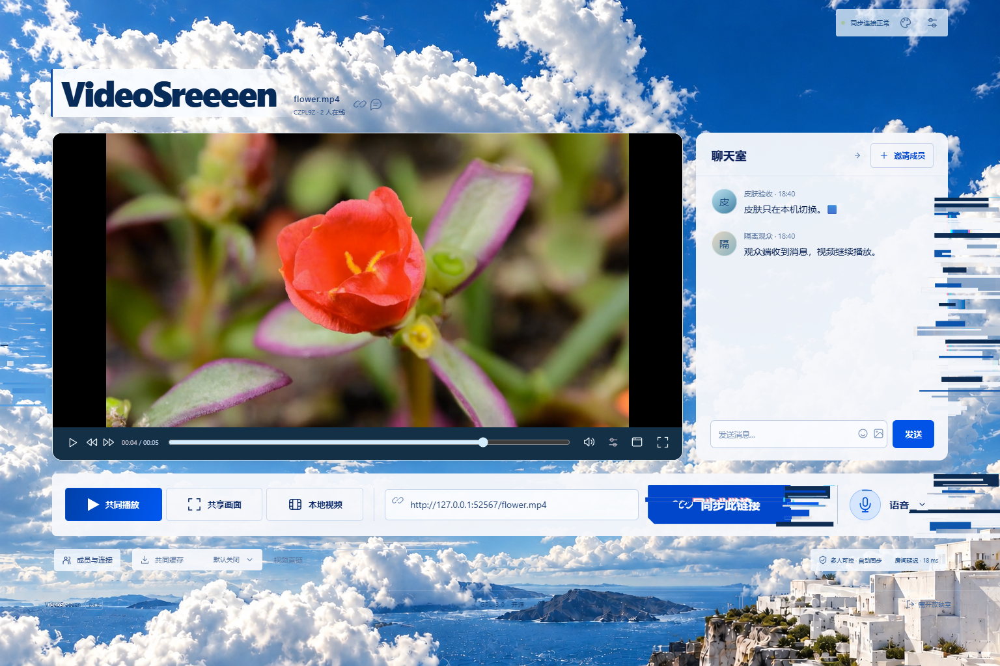

# A · 天光断层（Daylight Rupture）

最新正式站修订：邀请与语音入口不再整块擦除断层，按文字 / 图标实际范围保护；其他操作按钮接入一致的数据切片，聊天室收起图标恢复可见。详见 [边缘与按钮验收](verification-daylight-edges.md)。下文独立预览与早期实现为历史记录。

按用户提供的[参考 A 图](design/glitch-concepts/01-daylight-rupture.png)实现真实观影界面。2026-10-31 根据「条块像软糖、云朵不应写死、数据故障应由鼠标掠过产生」的反馈，重写动态绘制，移除固定断层 PNG 与平滑弹性拉伸。

旧 `daylight-a` 独立预览已于 2026-10-31 按用户要求删除，包含该分支的全部 5 次部署；删除后地址返回 404。本文以下保留当时设计及验证的历史记录。当前请使用[正式入口的天光主题](https://videosreeeen.pages.dev/?skin=glitch)，删除回执见 [daylight-preview-removal.json](daylight-preview-removal.json)。

## 实际界面

静止时是自然天空与完整面板：


鼠标依次扫过背景、聊天室和同步按钮后的瞬间：



这两张均为实际浏览器截图。头像使用真实发送者昵称首字符；示例视频不是主题素材。实录保存在本机 `.local/daylight-motion.webm`。

本次另逐帧检查了用户提供的按钮 WebP：29 帧、总长 2,890ms，文字和少量边缘横带突然错位，青红通道偏移之后有清晰的间歇。按这种节奏润色现有天空主题，没有照搬红黄配色，也没有将参考动图作为网站资产分发。此前知乎文章请求返回 403，本文不将未读到的文章内容作为实现依据。

随后已完整读取用户补充的 [Dragonir：仅用 CSS 几步实现赛博朋克 2077 风格视觉效果](https://www.cnblogs.com/dragonir/p/14878001.html)，重点参考按钮和图片的分层裁剪、阶跃位移、色彩重影机制。依照它的核心方式，将上一候选版分开的文字细线改为整块按钮合成层的局部裁剪平移；背景也改为原图层错位与像素排序尾迹结合。实现继续使用本项目的独立 Canvas，不复制文章代码或引入演示图片。

## 动态规则

- **故障只由本机指针触发。** 静止或动画结束时，两张装饰画布透明，没有冻结的云朵条块或固定损坏。鼠标扫过天空产生当前位置的照片行错位；扫过按钮或容器，故障从它的当前边缘产生。
- **材质实时生成。** 以当前天空原图做局部分层平移，再从主题照片与控件底色生成 96×48 小样本，按行、按不等长区间做亮度排序、重排源行及像素尾迹。没有读取影片、第三方页面或聊天内容的像素，没有 DOM 截图，也不加载固定的 `daylight-fracture.png`。
- **离散数据节拍。** 使用约 55–100ms 的不等长阶段，故障之间留出清晰间歇；横片分组突然改变长度、行内容和偏移。按钮采用少量较厚切片，容器混合大块缺损与细尾迹，减少均匀细线。部分采样行用相邻像素的 R / B 分量错位，形成轻微色偏。它是 datamoshing 风格的 UI 表现，不处理影片编解码。
- **按钮参考动效。** 同步按钮底色采用小切角，命中范围和标签不变。以自有底色、标签、SVG / CSS 遮罩图标合成一张本地底片，裁取约 3–7px 高的完整横带，连同底色、图标和文字一起以整数像素阶跃平移，并叠加窄幅青红重影。保留大部分字形连续，不再把文字和表面分开晃动；不复制交互节点，不处理聊天文字。
- **无弹性回落。** 取消正弦伸缩和连续位移曲线；条块以不等厚度与不规则间隙出现，生命周期约 840ms，后半程分批丢弃并清空，不缩回原位置。一个容器最多保留两个经过的位置，背景最多保留八次交互，余迹各自到期，不把整片效果黏在当前鼠标上。
- **轮廓可识别。** 卡片破损集中于侧边约 10%–20% 范围，主体内容保留；横向条块主要向外延伸。底栏按经过位置选择左 / 右边缘，按钮同时激活自己的边缘与所属底栏。拖拽时按实时边界重绘，旧位置清除。
- **内容区保护。** 每帧清除影片、控制栏、输入框、聊天气泡 / 消息信息与语音入口的装饰。普通边缘碎片仍避开按钮中央，仅自有按钮文字有上述限高切片。装饰没有命中区域，不移动实际控件，不提交房间操作。
- **减少动态效果时关闭故障。** 触屏保留干净界面；系统减少动态效果、强制颜色、隐藏页面与全屏都有相应停用 / 隐藏。退出全屏恢复背景，同一播放器和语音连接保持。

## 界面与资源

保留参考图的品牌、204px 标题区、影片 / 聊天等高双栏与贯穿底部的操作带。根据用户后续要求已删除右上「01 / DAYLIGHT RUPTURE」，品牌采用深蓝字与浅色渐变衬底。语音、成员、缓存继续使用原有 DOM 控件；切回「暖夜」恢复原布局。缓存仍仅属于共同播放、默认关闭。

天空照片为 `client/assets/themes/daylight-sky.png`，1536×1024、2,403,754 字节，使用 fixed / cover 图片直接展示。它不是 4K，超大屏仍有原始分辨率限制。两张透明显示画布和一张离屏天空画布上限均为 420 万像素 / DPR 2，交互约 30fps；没有活动交互时停止帧循环，切回原版释放 backing store。每次交互最多缓存四份图形：照片纹理为 96×48，按钮底片上限为 768×192，交互到期释放。

本轮没有重新生成图片。天空是此前通过内置 `image_gen` 从用户参考图移除 UI、再清除固定故障的资产，原始 PNG 保留在 Codex 生成目录。此前断层 PNG 已从运行代码、项目资源与构建输出移除；原始生成素材不受影响。

天空编辑提示词记录：

```text
Edit this existing production photographic background. Preserve its exact photographic composition: sunlit cumulus clouds in the upper-left, rich blue clear upper-right sky, lower framing clouds, blue Mediterranean island and sea along the bottom fifth, white seaside buildings bottom-right. REMOVE ALL of the baked-in digital corruption, rectangular streaks, horizontal pixel sorting, dark horizontal slabs, tiny colored blocks, scanline glitches and RGB offsets from the ENTIRE image, especially the dark strip clusters down the RIGHT EDGE and bottom-left. Reconstruct clean natural cloud detail and blue sky in those places. The finished plate must be a pristine sharp realistic daylight photographic panorama with no glitch marks at all; the application will generate the glitch dynamically from actual panel edges. Improve optical clarity and realistic fine cloud texture: crisp natural cloud edges, well-defined sea coastline and white architecture, no soft wash, no blur, no over-smoothed texture, no painterly appearance. Render at the highest native detail and resolution available, preferably 3072x2048 or larger, landscape 3:2. No text, logo, UI, frame, panel, typography, fake button, or inserted movie scene. Preserve original framing, lighting and natural colors.
```

皮肤可以在顶部调色盘 /「设置与帮助 → 界面皮肤」选择。首次随机分配、刷新保持和手动选择记忆不变；`?skin=glitch` 只选择本机外观，移除参数后保留邀请 hash，不写房间状态。

## 验证

构建、测试、录制、部署串行通过 `scripts/controlled.ps1 -AllowGameThisRun -MinFreeMiB 0`，使用隔离 Edge 和独立合成房间，不触碰用户正在观看的房间或麦克风。

- `npm run build`：类型检查、前端 / 服务端与助手构建。助手 ZIP 仍为 18,483 字节、SHA-256 `4c94b6e9c51934513326402fd1d34a21d42da72f3a3052349113f85b38a13307`；没有发布助手或客户端。
- `npm run test:appearance`：真实双端 MP4、实际房间 WebSocket、双向文字聊天、语音收听后换肤、拖拽、停靠、随机分配与偏好记忆。换肤保持同一 video，0 次 loadstart，没有暂停或房间操作。
- 动态检查分别验证「静止透明」「扫过后实际像素变化」「经过容器后拖动仍绑定新边缘」「旧位置不残留」「到期恢复原透明画布」。不再将固定纹理移动视为合格。
- 新增按钮合成层实际像素检查：中央出现青红偏移，受影响行数小于标签高度的 35%，图标可见笔画与标签具有共同的活动横行；DOM 标签不变，随后恢复透明。该检查防止只画文字划线或漏掉 CSS 图标，实际数值另见回执。
- 实时采样检查临时将隔离页面的天空替换为纯金色测试底图，实际碎片应出现同色像素，再恢复真实天空；同时确认没有旧断层图片网络请求。这是验证输入与输出关系的测试素材，不会加入产品或 README 截图。
- 装饰在影片和输入区域逐点采样应全透明；减少动态效果无变化，强制颜色隐藏，退出网页全屏后照片与画布恢复。检查 2560×1440、800×1100、1.5 倍 visual viewport、390 / 320px 布局；不是手机真机结论。
- `VS_TEST_SKIN=glitch npm run test:player-controls`：实际 MP4 / HLS、暂停、跳转、画面预览、精细定位、系统 / 网页全屏、约 1 秒闲置隐藏与窄屏操作。
- 公网独立预览使用实际 WSS 与受控视频 fixture，不等于 B 站 / 稀饭全部线路的真机验收。

参考：[Canvas drawImage](https://developer.mozilla.org/en-US/docs/Web/API/CanvasRenderingContext2D/drawImage)、[关闭图片平滑](https://developer.mozilla.org/en-US/docs/Web/API/CanvasRenderingContext2D/imageSmoothingEnabled)、[文字切片绘制](https://developer.mozilla.org/en-US/docs/Web/API/CanvasRenderingContext2D/fillText)、[背景轮廓裁切](https://developer.mozilla.org/en-US/docs/Web/CSS/Reference/Properties/clip-path)、[PixiJS GlitchFilter 原始着色器](https://github.com/pixijs/filters/blob/main/src/glitch/glitch.frag)。借鉴水平位移图、分通道采样的机制；本项目独立实现 Canvas 版本，没有复制着色器或引入其运行依赖。

本机证据：`.local/appearance-evidence.json`、`.local/appearance-public-evidence.json`、`.local/daylight-motion.webm`、`.local/daylight-scroll-evidence.json`、`.local/daylight-public-assets.json`。

## 前次部署回执（按钮参考润色前）

前一预览 `fa95d7c0`、源码 `26e5391` 使用固定照片条块，是这轮用户反馈的基线。

- 本轮源码 `7a1fbdd`；2026-10-31 部署到独立 Pages 预览 `0253c709`，固定地址 <https://0253c709.videosreeeen.pages.dev/?skin=glitch>，别名 <https://daylight-a.videosreeeen.pages.dev/?skin=glitch>。
- 最终构建、本地和公网 `test:appearance`、A 皮肤 `test:player-controls` 通过。真实双端 MP4、文字聊天、语音收听后换肤、拖拽 / 停靠、皮肤记忆与全屏恢复正常；保持同一播放器，0 次 loadstart，换肤没有房间控制。MP4 / HLS 预览、精细定位、暂停 / 跳转与约 1 秒闲置隐藏回归通过。没有访问物理麦克风，不是手机真机结论。
- 公网活动边缘采样：移动前深色 1,541 / 浅色 12,513 像素，移动后新边缘深色 3,189 / 浅色 12,837，旧位置均为 0。静止后恢复透明。数值只验证输出位置与清理，不代替主观风格评价。
- 实时取样检查：本地纯金色底图产生 1,481 个同色实际碎片像素，公网产生 4,353 个；两端均无旧断层 PNG 资源请求。测试后恢复正常天空，影片未被用作素材。
- 实录 `.local/daylight-motion.webm`：5.45 秒、1152×768、576,408 字节。已检查连续截帧中条带的保持 / 跳变、独立丢弃及恢复，未制作概念图动画。390×844 窗口滚动 325px 后照片仍完整 cover，缩略采样 982 种照片色值。
- 公网 HTML、6 个资源及预览别名与本地构建逐字节一致。入口 `index-eqo0Z8D4.js` SHA-256 `7ad76bc3baaf3a8b00cdcfcb194c609886729a2f2fb37cfcdb86cf80fc48c089`；CSS `index-Ba_wyFUD.css` SHA-256 `36964723dad06c659c2a257154da243899f4a25a8962111a3382bcd74338b35d`；天空 SHA-256 `48e5b26cbf31428e23df58d83d4770edb5fdf4655f2dea3298e25e9f935cba69`。
- 正式入口仍为 `assets/index-ByAASs3a.js`，未改房间 Worker / Durable Objects、用户房间状态、已发布客户端或助手，没有创建付费资源、TURN、标签或 Release。代码只推送现有开发分支，不触发手动客户端发布工作流。
- dist 与 Pages 上传目录各约 3.18 MiB，比上一预览各减少约 2.09 MiB；服务端输出约 0.28 MiB。当前输出原位覆盖，继续使用 `.local/rollback/manifest.json` 中的唯一回退，没有新增候选安装包或备份目录。D 盘可用约 45.71 GiB。

## 本次回执：按钮与原图分层切片

- 运行时代码 `52ce2c5`；2026-10-31 已部署独立 Pages 预览 `b7bf764c`，固定地址 <https://b7bf764c.videosreeeen.pages.dev/?skin=glitch>，别名 <https://daylight-a.videosreeeen.pages.dev/?skin=glitch>。文章与动图参考下的最终合成层实现以此版本为准。
- 构建、格式检查、本地与公网 `test:appearance` 通过；A 皮肤 `test:player-controls` 通过真实 MP4 / HLS、跳转与预览、精细定位、全屏与闲置隐藏，错误列表为空。视频和语音收听后换肤对象不变，聊天与拖拽 / 停靠正常；未访问物理麦克风，不代表手机真机验收。
- 本地按钮标签 24px 高，实际活动为 8 行，图标有 8 个相同活动行及 10 个可见字形像素；公网同样为 8 个共享行、21 个可见图标字形像素。标签内容保持「同步此链接」，结束后装饰画布恢复透明。此检查覆盖 CSS 遮罩图标和标签，验证整层切片的共同运动。
- 公网拖拽后旧边缘的深浅像素均为 0；实时采样测试底图得到 1,268 个同色碎片像素，未请求旧断层 PNG。视频、进度控件、输入和聊天正文仍避开装饰。
- 实录 `.local/daylight-motion.webm` 为真实隔离页面捕获：5.4 秒、1152×768、588,567 字节；参考与输出的逐帧诊断图片检查后已清理，原始附件不变。README 中静止 / 活动截图已更新。
- 公网 HTML、6 个资源和预览别名与本地构建逐字节一致。入口 `index-DcNDC8G6.js` SHA-256 `e8411ff1580f6dddb844b198f748ce85027735df54dec56305bc891f55bbaff3`；CSS `index-B9jvsOT-.css` SHA-256 `eac9a98faa270cc693340ea2870d5107592a69b8f216d4350948ad3fcd19dded`。背景资产保持原哈希。
- 正式入口仍为 `assets/index-ByAASs3a.js`，房间 Worker / Durable Objects 未更换，没有影响正在观看的房间，没有新客户端包、标签、Release、付费资源或 TURN。代码和说明只推送当前开发分支。
- dist 与 Pages 上传目录仍各约 3.18 MiB，服务端约 0.28 MiB，沿用唯一回退，没有新增备份或安装包；本轮结束 D 盘可用约 45.54 GiB。
