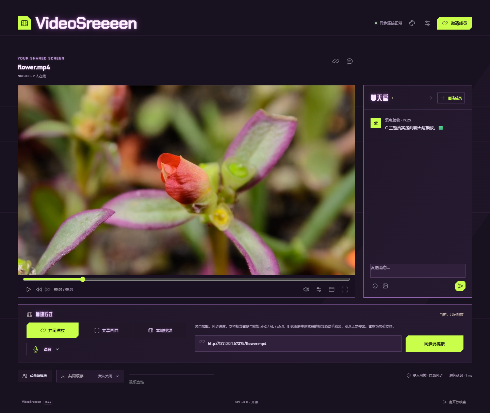

# C「紫电噪讯」主题

2026-10-31 新增主题字体与稳定霓虹光晕：品牌采用 Chakra Petch，聊天室等固定标题采用站酷庆科黄油体，正文与播放器数字保持系统字体。天光 / 紫电的局部悬停改为每次进入约 50% 概率触发，幅度与大小在受控范围内随机变化；紫电背景仍只响应按钮激活。最新实现与部署证据以[交互与字体修订](verification-theme-interaction.md)为准，下文保留先前基线。

最新界面修订：聊天室拖拽已移除，改为右侧收起 / 展开；语音弹层覆盖顺序与窄屏定位修正，见[聊天与弹层验证](verification-sidebar-layout.md)。下文的初次 C 发布记录保留为历史基线。

2026-10-31 背景触发方式修订：监听全页按钮激活，不使用装饰按钮白名单；原生按钮、按钮语义控件和展开菜单均可触发。鼠标移动、悬停或仅聚焦不再触发背景。暂停 / 播放等操作保持原有功能，背景装饰仍位于内容之后；全屏、减少动态效果与短时冷却保护保留。

该修订源码 `fac6dbd` 已更新正式 Pages，部署 `a0570868`，没有新增预览分支或部署房间 Worker。构建和本地 / 公网 `test:signal-theme` 均通过：背景移动与悬停不触发、鼠标点击和键盘激活触发，非装饰白名单按钮同样触发；原有双端播放、语音收听、聊天、全屏和 31 帧视频保护检查通过。公网证据的 `backgroundOnlyOnButtonActivation`、`checksPassed`、`cleanup` 均为 true，麦克风申请为 0。线上 HTML 与全部 11 项静态资源 SHA-256 一致，详见 [背景交互部署回执](signal-background-deployment.json)。未刷新正在观影的用户房间，未新建安装包或回退副本。

用户从四版无照片故障艺术方案中选定 C，要求作为新主题加入应用。本次新增 signal 主题，保留 classic 与 glitch，不替换原有选择。

## 使用

打开[网页版](https://videosreeeen.pages.dev/?skin=signal)可以选择并记住 C；已有房间也可点击顶部调色盘，在「界面皮肤」选择「紫电噪讯」。没有固定偏好时首次随机分配包含三款；同标签页刷新保持，点击「随机选择」清除固定偏好。

截图为独立房间、隔离浏览器和 MDN CC0 样片，昵称与文字为验收内容。成员、聊天室传递和服务器 RTT 来自实际连接，不是界面概念图。窄屏为桌面浏览器视口检查，未声称手机真机验证。

## 外观与资源边界

- 紫黑背景、酸绿按钮、几何分区，无照片背景。原色酸绿 #c9ff4b 的实际 RGB 反相为 #3600b4。
- 使用所选 C 方案相同的 1–3 像素细横带、steps(1) 与 680 ms 时序；按钮底色、文字和 SVG 在同一副本中反相，与原色副本反向错位。
- 只复制受控按钮的非交互显示内容。装饰设为 aria-hidden、inert 和 pointer-events:none，移除副本 ID / name，不复制播放器、输入框、iframe 或语音流。动态按钮更新后同步副本。
- 容器特效放在自身 overflow clip / paint containment 的装饰窗口，实际语音 / 成员菜单可正常展开，不用裁切整个业务容器来隐藏菜单。视频与输入不参与取样或重新编码。
- 展开的语音 / 成员弹层与任何全屏中隐藏相关装饰。开启前也检查宿主和播放器矩形是否相交，避免容器越界覆盖视频。聊天室已按最新反馈移除拖拽，改为向右收起 / 展开。
- 背景仅在用户点击页面按钮时短暂闪动，鼠标掠过背景或聚焦按钮均不触发背景；键盘 Enter / 空格激活按钮同样可触发。按钮与容器边缘保留原来的局部悬停动效。有限动画保留冷却，不会持续闪动；没有常驻 Canvas、后台绘制循环或媒体采样。主题切换、页面隐藏、全屏和系统减少动态效果时停止；离开 C 断开 DOM 观察并移除显示副本。
- 控件布局只移动已有节点并保留原位锚点，视频、音频及语音对象不重建；C 的房间标题保留原位置，通过 Grid 排到影片上方，避免退出全屏后的窄屏错位。

## 本地验证

受控入口执行 npm run build 后，再对构建产物执行 npm run test:signal-theme 和 npm run test:appearance。

- 新 C 的首次分配、刷新保持、手动固定与三款设置入口通过。
- 新建本机隔离双端房间，播放 CC0 MP4；播放过程中切换 classic → glitch → signal，视频 / 音频 / 语音节点不变，没有新增 loadstart，没有主题引起的 control / media / mode / cache / unshare 消息。观众仍为自己的 classic 主题。
- 语音只加入收听，切换后收听状态保持；真实麦克风申请数为 0。没有录音、合成之外的物理声音或设备操作。
- C 的真实文字 / Emoji 聊天可传到观众，暂停可同步到观众。
- 同时激活背景、面板和按钮，在 0–900 ms 每 30 ms 采样，31 帧真实已解码、暂停的视频矩形均与基准相同，观测最大通道差异为 0；测试容差为每通道 1/255，以容纳浏览器合成舍入。
- 检查实际 invert(1)、steps(1) 和装饰不接收点击；有限动画结束，无静止悬停常驻效果。
- 聊天室收起后宽屏视频占满释放的空间，展开恢复原尺寸；网页全屏、浏览器系统全屏、Esc 退出后保留同一视频节点。
- 390 / 320 像素窄屏无横向溢出；退出全屏后标题仍在播放器上方，三款皮肤入口可操作。
- 系统减少动态效果时关闭故障动画。旧主题完整 appearance 回归另检查随机与存储受限、刷新、聊天收起 / 展开、两个全屏和媒体持续播放。

本机证据在 .local/signal-theme-evidence.json 和 .local/appearance-evidence.json。新主题检查脚本为 scripts/signal-theme-check.ts；可重复入口为 npm run test:signal-theme。类型检查包含新客户端和验证脚本。

## 部署与范围

集中发布前先在独立预览运行同一套公网双端检查，再更新正式 Pages。房间 Worker、播放协议、原站取源、缓存规则和语音编解码均不在本轮修改范围。不会操作用户正在观看的房间，不强制刷新已打开的网页。

2026-10-31 已完成集中发布：

- 独立真实应用预览：[signal-c](https://signal-c.videosreeeen.pages.dev/?skin=signal)，验证部署 `47d90f3b`。完整公网双端检查通过，包含直接链接、偏好记忆、播放 / 聊天、语音收听保持、两种全屏、31 帧视频比对与浏览器干净退出。
- 正式 Pages 仅发布一次，固定部署 [c6fbcb99](https://c6fbcb99.videosreeeen.pages.dev/?skin=signal)，入口仍为 [videosreeeen.pages.dev](https://videosreeeen.pages.dev/?skin=signal)。同一构建的正式入口另以全新隔离房间运行同套检查，全部通过；没有控制、刷新或改动用户的房间。
- 正式 HTML 与全部 11 项资源逐一下载，SHA-256 均与本地构建一致；`/healthz` 确认原房间绑定健康。完整回执见 [部署资源哈希](appearance-signal-deployment.json)。入口 `assets/index-BUyJWr3n.js`，SHA-256 `a342af9ae9a740a0e2cad1ee72e61b496d8ed79d8343931d7b37eddc5f6ca032`；样式 `assets/index-B2i2qJGR.css`，SHA-256 `82a925321cd7e2abb5e08c78367d249f64316b3d39962700e107e9b4ca841299`。
- 只更新 Pages 静态前端及原样的 Service Binding 入口，没有部署房间 Worker 或修改房间状态。预览与正式测试使用同一既有免费房间服务，不启用付费产品。
- 浏览器取源助手 ZIP 的 SHA-256 仍为 `4c94b6e9c51934513326402fd1d34a21d42da72f3a3052349113f85b38a13307`。客户端安装包与 Release 不在本轮发布范围，不宣称已有 v0.4.6 安装包包含 C；新增源码随后续独立打包进入客户端。

公开证据覆盖写入 `.local/signal-theme-public-evidence.json`，包含正式入口、同一媒体 / 语音节点、零麦克风申请、零换肤房间操作、31 帧最大差异 0、检查与清理均通过。素材为受控 CC0 请求，未以此冒充原站实播或真机音频验收。

本轮当前 Web 构建约 3.20 MiB、Node 构建约 0.28 MiB，Pages 上传目录为同一当前版本；没有新增 APK、桌面包或历史归档。项目唯一既有回退由 `.local/rollback/manifest.json` 定位，未增加多套回退；D 盘检查剩余约 49.89 GiB。
