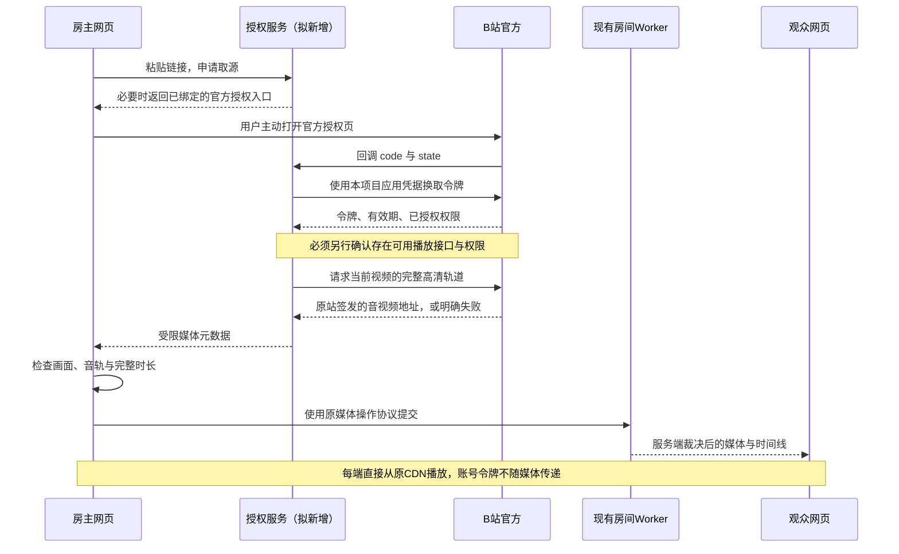

# B 站全网页授权与高清共同播放设计

2026-10-28。目标是房主和观众都使用浏览器：房主粘贴页面链接，必要时前往 B 站授权，回到房间继续播放。Windows 取源作为现有可用选项保留。

**状态：官方 OAuth 路径完成设计与公开能力核查，尚未上线。** 当前正式版仍为 0.4.5。另有默认关闭的 Node 扫码取源实验实现，结果见[网页扫码验证](verification-bilibili-web-session-trial.md)。官方 OAuth 可以建立第三方应用身份，但能否取得任意 BV 的完整高清轨道仍未证实；两项能力必须分别验收。

## 已核实的前提

本次直接读取 B 站官方站点公开文档目录及其原文，未使用用户登录态，也未保存原始响应。Apifox 文档作为可读参照；下列稳定链接指向原站对应文章。

| 问题                                       | 结果与依据                                                                                                                                                                                                                                                                                          |
| ------------------------------------------ | --------------------------------------------------------------------------------------------------------------------------------------------------------------------------------------------------------------------------------------------------------------------------------------------------- |
| 能否跳转 B 站授权后返回我们的网站？        | 支持第三方网页 OAuth。PC 与移动 H5 均有入口，需注册应用 ID、匹配的回调域名与随机 `state`。见[网页应用接入](https://openhome.bilibili.com/doc/4/aac73b2e-4ff2-b75c-4c96-35ced865797b)。                                                                                                              |
| 回来就有可用 token 吗？                    | 官方返回短期授权码，由服务使用本项目的 `client_id` / `client_secret` 换取 `access_token` 与已授权权限。令牌有效期与权限由返回结果决定。见[账号授权](https://openhome.bilibili.com/doc/4/eaf0e2b5-bde9-b9a0-9be1-019bb455701c)。                                                                     |
| 普通登录页是否等同于第三方授权？           | 不等同。第三方授权依赖已注册应用与回调；仅打开 `passport.bilibili.com/login` 不能据此得到本项目的 OAuth 回调。                                                                                                                                                                                      |
| token 是否自动拥有高清取源权限？           | 尚无证据。本次公开文档目录未找到任意 BV 的高清播放地址接口；公开视频查询接口面向授权用户自己的投稿，返回页面 / iframe 信息，不能当成 AVC / AAC 地址。见[稿件详情](https://openhome.bilibili.com/doc/4/d9554788-dcef-f139-6217-b487d41c3826)。目录缺失不证明不存在合作能力，但不能据此假定已经支持。 |
| 个人能否直接注册应用？                     | 此次官方入驻文档仍写明暂未开放个人开发者入驻，需要资质及应用审核。是否具有现成应用尚未确认。见[入驻](https://openhome.bilibili.com/doc/4/cbdcee3b-f57e-5c7b-cf27-83892fb811c4)、[应用管理](https://openhome.bilibili.com/doc/4/7702bf71-673f-8085-e93f-2014917e0da7)。                              |
| 现有 1080p 实播能否证明这个 token 可取源？ | 不能。此前实播使用的是正常已登录原站会话，现有 Windows 代码也使用该会话。OAuth 开放接口令牌与原站网页会话分开验证，不能把前者直接当成后者。见[真实账号取源复验](verification-bilibili-authorized-source.md)、[0.4.5 接入验证](verification-bilibili-account.md)。                                   |
| Workers 能否负责网页授权？                 | 可以设计成由现有 Worker 处理回调、换取令牌和取源元数据；能否访问实际取源接口仍需单独验证。此前 B 站返回 Cloudflare HTTP 412 的问题不会因增加授权按钮而自动消失。视频继续从原 CDN 加载，不引入视频代理、付费服务或新 VPS。                                                                           |

## 用户操作

1. 房主进入网页房间，在“共同播放”中粘贴 B 站页面链接，点击同步。
2. 如果具备有效授权，直接识别视频；确实需要授权时，在链接旁出现“前往 B 站授权并继续”。不默认打开新窗口。
3. 点击按钮，进入官方 PC / H5 授权页。浏览器已经登录时，是否仍需确认由 B 站决定，不读取或导入浏览器 Cookie。
4. 完成授权，回调页处理结果。原房间继续保留，自动续接同一 BV / 分 P。音视频首帧与时长检查成功后才换片。
5. 观众直接在网页观看，账号 token 不进入邀请、聊天、房间快照或视频请求。

日常仍只有“粘贴链接 → 同步”；只在授权过期、撤回或首次需要时追加官方授权。授权成功和高清取源成功各自有真实状态。若应用没有播放能力，则不向用户开放这项入口，避免让用户登录后仍等待无法完成的识别。

## 流程与状态所有权

授权服务不写房间时间线，不替代现有房间服务。沿用现有媒体版本、操作去重、冲突裁决和取消逻辑。房间加入身份与 B 站账号身份分离，不按昵称或 B 站账号合并成员。

取源适配器可以共用现有 BV / 分 P、完整时长、非预览 / 非 DRM、音视频格式、原 CDN 与期限校验，但认证要独立实现。当前 `resolveAccountBilibiliPage` 依赖原站会话，不能仅把请求参数改成 `access_token` 就视为接入完成。失败、取消或换房保持当前影片；源站权限、付费与设备解码边界继续保留。

## 授权与取源的接口边界

以下是待实现接口，不是现有能力：

| 本应用接口                        | 行为                                                                                                           |
| --------------------------------- | -------------------------------------------------------------------------------------------------------------- |
| `POST /auth/bilibili/attempt`     | 为当前浏览器及发起标签页创建一次性授权事务，返回状态与固定官方入口；不返回账号凭据。                           |
| `GET /auth/bilibili/callback`     | 检查绑定关系、随机 state、时效和一次性消费，使用 code 换取令牌；完成后清除地址栏查询参数。                     |
| `GET /auth/bilibili/status`       | 仅向同一浏览器与发起标签页报告授权结果、到期与实际播放能力。短期有界查询，后台停止轮询，不与房间心跳混用。     |
| `DELETE /auth/bilibili/session`   | 清除本应用持有的授权材料，阻止后续取源；原站撤销授权按正式能力接入，不伪称本地删除可以吊销已签发 CDN 地址。    |
| 既有 `POST /resolve-source/:room` | 维持成员凭证校验，仅新增经授权服务取源的内部适配器；入参仍是页面链接，不接受客户端提交任意上游 URL 或 Cookie。 |

PC / 移动端使用文档指定的各自官方授权入口。回调域固定为已登记的正式域名，不从请求的 Host、邀请码或用户输入生成。Pages 将上述授权路由通过现有 Service Binding 转到同一个 Worker；不能新增一套独立房间状态。

优先用新标签页完成授权，原房间标签页保留连接与待处理请求；新页使用 `noopener`，原页通过受限状态接口获取结果，不依赖任意来源的 `postMessage`。若后续支持同标签页跳转，应为这次明确发起的授权增加一次性恢复凭据；不能放宽“新导航不接管旧成员”的现有规则。

## 令牌保管需要明确变更的范围

原约定是原站登录态只保留本机；用户随后于 2026-10-28 明确允许本次短时服务端取源验证，退出或到期删除，维持零付费。这项验证授权不自动扩大为所有用户的长期云端凭据保管。官方网页 OAuth 的 code 换取需要应用 secret；拟议网页方案由服务短期处理 OAuth 令牌，**这与当前客户端本机保管会话是不同模式**。即使加密，也不能宣称令牌从未到达服务端。

拟议默认：

- 仅保管本次用途的 OAuth 授权；不收集密码、不导入系统浏览器 Cookie、不上传现有客户端会话。
- 应用 secret 放 Worker Secret，不进入前端、仓库或浏览器 URL。按官方接口要求完成上游换取，任何日志都不记录完整上游请求或响应。
- 每个授权会话独立，浏览器仅持有 `Secure` / `HttpOnly` / `SameSite` 的本应用随机会话标识，标签页另有绑定证明；OAuth token 不放入 localStorage、邀请或房间对象。
- 若使用独立授权 Durable Object 持有短期加密记录，密钥与记录分离，设置到期清理；服务内部能够使用明文令牌，因此仍属于服务端处理凭据。资源沿用免费方案，正式创建之前核对授权与额度。
- 不默认持久保存 refresh token；首次版本按原站返回期限及本应用短期会话上限失效，主动退出、撤回或超时后停止新取源。后续“记住授权”作为单独选择，不偷偷延长。
- 授权事务随机 state 至少 32 字节，一次性且短期有效；绑定浏览器、标签页、原请求及媒体版本。并发回调、重放、换房或过期结果不能继续旧请求。
- 所有普通授权 API 需要本应用固定来源与防跨站请求检查；回调允许来自原站的顶层跳转，但必须通过 state 与会话绑定。不能复用房间 API 对 `null` / 原生来源的宽松设置。

## 先验证播放能力，再建设登录入口

1. **确认可用权限。** 对照正式开放能力、项目可取得的应用权限或原站明确答复，确认能否获得目标 BV 的完整高清轨道。本次核查未找到这项公开权限；不编造 scope，不把投稿或用户信息权限当成观看权限。
2. **验证令牌与取源接口。** 有合法应用及权限后，使用其真实 OAuth 授权，在不借用原站 Cookie 的条件下取得同一完整视频。不得使用别的应用 ID / secret 或把 OAuth token 当成 Cookie 去冒充原站会话。
3. **验证现有云出口。** 单独验证 Worker 能访问实际授权及取源接口；记录登录问题、权限不足、源站 412 等不同结果。若云出口仍不可达，保留当前影片，不能将授权成功当成问题已解决。
4. **验证网页播放。** 房主与没有账号会话的独立观众均实际解码 1920×1080 和 AAC，确认时长、持续播放、拖动、暂停、换分 P、地址到期与取消。扩展上下文、本机成功、菜单列出 1080p 都不能代替这一步。
5. **再实现正式 UI。** 只有前四项有证据，才启用全网页入口、发布客户端或更新 README 的兼容承诺；没有必要为一个尚不能取源的登录页面发新版本。

## 官方令牌无法取流时的候选路线

可另行研究“网站扫码登录 + 专门的取源服务”：房主明确确认本次登录，服务使用该授权产生的原站会话取源，再让网页各端直接从原 CDN 播放。这与开放平台 OAuth 是两种认证，不应混称为同一个 token。

用户已批准本次短时服务端验证，Node 实验入口已实现并通过合成登录与双端播放检查。真实扫码后的完整取源尚未完成；本轮真实 Cloudflare 出口连二维码接口也返回 412。**这不是已确认可用的正式替代品**，详见[分层验证记录](verification-bilibili-web-session-trial.md)。不能仅通过修改网页 JavaScript、普通跳转、Service Worker 或加密包装消除这些条件。

浏览器扩展和 Windows 本机取源继续属于可选能力，不作为全网页设计的隐藏前提。现有共同播放、聊天、语音、缓存与实时共享链路保持各自职责。
