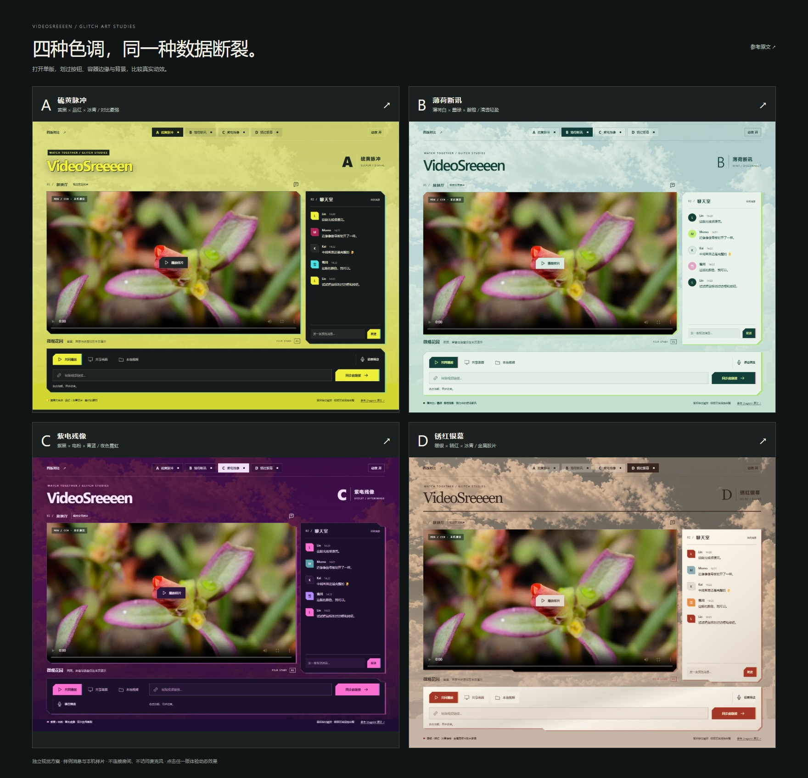

# 四版 CSS 故障艺术重写方案 · 第二版

用户已选定 C「紫电噪讯」，并作为新主题接入真实放映厅，见 [C 主题使用与验证](../../appearance-signal.md)。本目录继续保留四版独立视觉对比，不连接房间。

根据用户反馈，第一版仍沿用照片背景、切片粗短，且播放器内部层级检查不足以排除相邻容器越界。本版重新制作 HTML、CSS、动效层及四套图形版式，移除全部照片背景依赖。影片中的植物是 CC0 样片，不是页面背景。

**[四版对比](https://article-four.videosreeeen.pages.dev/board.html)** · 进入单版后，划过按钮、面板上下边缘或空白区域体验有限动效。



| 方案                                                                  | 版式与配色                           | 动效                       |
| --------------------------------------------------------------------- | ------------------------------------ | -------------------------- |
| [A · 明黄断电](https://article-four.videosreeeen.pages.dev/?scheme=a) | 明黄底、碳黑面板，斜切与条纹         | 760 ms，明黄按钮的蓝紫反相 |
| [B · 赤白偏移](https://article-four.videosreeeen.pages.dev/?scheme=b) | 纸白底、朱红按钮，直角与印刷分隔线   | 820 ms，朱红按钮的青色反相 |
| [C · 紫电噪讯](https://article-four.videosreeeen.pages.dev/?scheme=c) | 紫黑底、酸绿按钮，紧凑双行控制台     | 680 ms，酸绿按钮的蓝紫反相 |
| [D · 钴蓝反相](https://article-four.videosreeeen.pages.dev/?scheme=d) | 钴蓝底、米白面板、橙色按钮，衬线标题 | 840 ms，橙色按钮的蓝色反相 |

## 动效实现

按钮原色与其实际 RGB 反相分别为 A `#e9ef24 → #1610db`，B `#ed3b28 → #12c4d7`，C `#c9ff4b → #3600b4`，D `#f37837 → #0c87c8`。反相直接作用于按钮副本的底色、文字和图标，不是另外挑一块近似撞色来冒充。

第一参考为 Dragonir 的 [《仅用 CSS 几步实现赛博朋克 2077 风格视觉效果》](https://www.cnblogs.com/dragonir/p/14878001.html)。参考其高对比色、分层裁切与阶跃位移机制；页面、切片与时序独立实现，没有复制原文图像或完整代码。

- 原色和反相：同一按钮底色、图标和文字分别形成两个无交互副本，一层使用真实 CSS invert(1)，另一层保留原色；在相邻细带上分别向左右错位。面板同样使用材质的反相层与反方向色带。
- 切片比例：裁切带高 1–3 CSS 像素，保留横向长条。按钮使用其完整宽度，面板沿上下边缘展开，不再先截成左右窄边再切成粗短块。
- 动画：steps(1, end) 离散切换，有清晰停顿，无弹簧、缩放或竖向弹跳。一次动效不足一秒，静止后结束，支持关闭和系统减少动态效果。
- 背景：纯色、几何分区与细线；没有外部背景图、天空素材、照片采样、固定故障纹理。
- 遮挡边界：每个按钮和面板自身具有 paint containment 与 overflow clip。特效不能逸出宿主压到相邻视频；视频本身没有故障副本、反相滤镜、动画裁切或破碎按钮。

## 验证与范围

验证会同时开启所有动效，对四版各采样 31 帧，比对视频区域截图；相邻组件也参加激活，能够发现只检查播放器内部 z-index 所遗漏的越界。仅允许浏览器合成产生的每通道 1/255 舍入差异，超过即失败。另检查真实反相滤镜、原色层、相反位移、无照片背景、停止动效及 390 / 320 像素窄屏。

这是独立视觉方案，不连接房间，不申请麦克风、共享或文件权限。聊天初始内容标为样例；新消息只留本页内存；播放器使用本机播放的 MDN CC0 样片。切换输入面板、收起聊天、预览语音面板和发送本机消息可操作；链接提交明确提示不会同步真实房间。未替换正式放映厅。

## 复现与素材

在仓库根目录串行执行受控入口：

```powershell
./scripts/controlled.ps1 -File node.exe -Arguments @('scripts/article-glitch-check.mjs') -AllowGameThisRun -MinFreeMiB 0
./scripts/controlled.ps1 -File node.exe -Arguments @('scripts/build-article-glitch.mjs') -AllowGameThisRun -MinFreeMiB 0
```

浏览器检查使用隔离 Edge 和已有 .local/flower.mp4。截图覆盖为 a.jpg 到 d.jpg 和 overview.jpg；仅生成一份 .local/article-glitch-dist，分发不包含天空图。poster.jpg 来自 MDN CC0 flower.mp4 第 2 秒；视频不提交、不打包，仅点击后从 MDN 原地址加载。代码 GPL-3.0-only。

[验收记录](../../verification-article-glitch.md) · [当前部署哈希](deployment.json)
