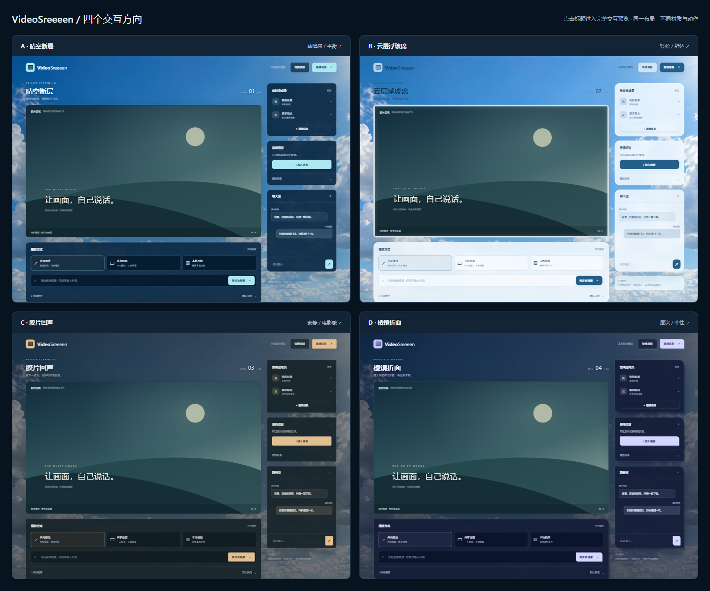

# 2026-10-31 四版交互提案验证

独立预览：[切换体验](https://d3c19eeb.videosreeeen.pages.dev/index.html)、[并排总览](https://d3c19eeb.videosreeeen.pages.dev/board.html)。Pages 预览分支为 `skin-directions`，部署 `d3c19eeb`；与正式入口、房间服务和 Durable Objects 分离。方案待用户选定，不合并或替换正式皮肤。

源代码位于 `codex/skin-directions-20261031`，实现提交 `4bcc6b3`；仅增加原型目录和验证脚本，`client/`、`worker/`、`server/`、发布工作流、安装包和 Release 均未改动。没有推送 main 或创建 PR，因此不触发 main 的 Verify 或客户端发布工作流。

本机与公网分别运行 `scripts/skin-directions-check.mjs` 均通过：四方向背景真实像素响应、冲量演变后稳定、整面材质动画、按钮反馈、320 / 390 / 1440 / 2000 像素布局、减少动态效果和本机演示输入。公网证据 `.local/skin-directions-public-evidence.json`，截图 `.local/screenshots/skin-*.png`；所有浏览器请求限制为预览同站点，无房间 / 麦克风 / 第三方请求。窄屏为桌面 Edge 视口，不代表手机真机验收。

已核对预览的 index、board、CSS、JS、WebP 和 README 共 6 项资源 SHA-256 与本地一致；回执 `.local/skin-directions-public-assets.json`。JS `a28a7c2c00d457a00f8375ea9ad0ababafab11dcaa46277287e31b847d6d50dc`，CSS `3454e6297428364fc4e342e23233fa96712e6f90ceb68f56a9d3c80aa0dd10e8`。额外核对正式入口仍引用 `assets/index-ByAASs3a.js`，未因上传预览变更。

新干净蓝天素材由内置 image_gen 生成，保存为 [sky.webp](skin-directions/sky.webp)，102,094 字节，SHA-256 `bf96b7665a8227b526d4acf76e2dd62b761c7249c0b82543850ea2df21bdfda8`。完整提示词与交互设计比较见 [方案说明](skin-directions/README.md)。原始 PNG 保留为源素材；没有覆盖原故障皮肤、增加客户端包或建立额外回退版本。四个方向是本次明确要求的设计备选，截图各自展示当前同一套候选方案。
