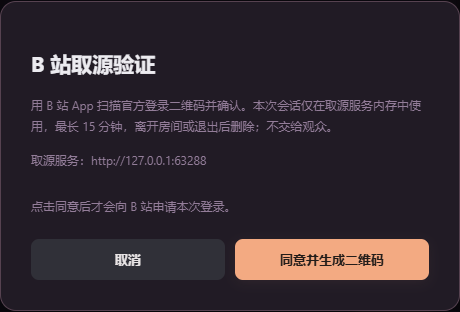

# 网页扫码取源验证（未发布）

2026-10-28，用户允许房主主动扫码确认后，由验证服务短时处理本次 B 站会话，退出或到期删除，维持零付费。实现与结果分层记录如下。正式网页仍为 0.4.5，本次没有发布新的 Windows / Android 安装包。

## 现有免费云出口的实际结果

先使用远程预览探测，预览转发未就绪，因此没有把本机模拟结果当成云出口证据。随后在已授权账号创建独立、随机访问密钥保护的 `videosreeeen-source-trial` Worker，仅请求固定原站匿名接口。未发送任何账号 Cookie、未启用收费服务、未更新正式房间 Worker。

真实 Cloudflare NRT 出口、正常 API 请求头、禁止自动跳转的结果为：

| 原站接口                                           | HTTP | 原站代码 |
| -------------------------------------------------- | ---- | -------- |
| 官方账号状态 `/x/web-interface/nav`                | 412  | -412     |
| BV 元数据 `/x/web-interface/view`                  | 412  | -412     |
| 登录二维码 `/x/passport-login/web/qrcode/generate` | 412  | -412     |

这说明本轮云出口在匿名生成二维码时已经受阻，尚未到账号确认阶段。**不能宣称增加 Cookie 后已解决 412，也没有证明登录后的云端取源成功。** 探测版本为 `84f1932b-0557-4396-91fe-91a4392c379a`；证据摘要在本机忽略目录 `.local/bili-web-preflight-evidence.json`。独立探测 Worker 已删除，没有存放账号会话，正式放映厅资源未删除或迁移。

同一时段，本机通过用户既有 Clash 代理读取上述元数据与生成二维码均为 HTTP 200 / code 0。本机向接口携带第三方页面 Origin 的匿名请求另返回 HTTP 403，不能据此假设普通网页可直接调用这些登录接口。未修改系统代理、路由、防火墙、边缘设备或 EasyTier。

## 已实现的实验入口

- `createApp({ bilibiliWebTrial: true })` 显式启用 Node 实验模式；普通 Node 启动默认关闭，现有公共 Worker 未接入此能力。`/config` 与本机 `/healthz` 标注实验能力。
- 网页仍粘贴普通 BV 页面。缺少会话时显示“扫码登录并继续”；弹窗列出实际取源服务地址和保管期限，用户点击同意才生成官方二维码。
- 账号会话仅进入服务内存中的独立私有映射，不写磁盘、不存到房间对象、不返回网页，不交给观众。只保留正常登录响应中的 SESSDATA，不保留刷新令牌；最长 15 分钟，原站签发期限更短时采用更短期限。取消、离开、超时或服务结束清除引用并取消请求。
- 匿名登录请求只到固定 passport 接口；使用会话的请求只到既有 B 站只读元数据白名单。拒绝自动跳转、异常来源、错误 Cookie 作用域、超大响应及过期数据，不使用试看参数或其他应用密钥。
- 官方当前二维码指向 `https://account.bilibili.com/h5/account-h5/auth/scan-web`。最初只接受旧 passport 路径，真实探测定位并修正；保留原站原始链接，严格检查新版与旧版的域名 / 路径 / key，不猜确认地址。二维码在浏览器本地生成，不发送给第三方二维码服务。
- 成员鉴权、同源检查、HTTPS / 本机回环限制、一次登录事务标识、并发与响应大小限制保持。旧取消和迟到响应不能覆盖新事务。已有房间媒体仍由既有操作协议发布，首帧、音轨、完整时长和访问权限检查后才允许替换。



截图来自本机隔离测试，尚未生成登录二维码，不包含真实账号或登录材料。

## 自动验证

安全测试覆盖默认关闭、成员隔离、凭据不出现在响应、Cookie 仅发给固定元数据接口、同源检查、官方二维码地址、错误作用域、期限、停止、离开及迟到响应。

`npm run verify` 的 104 项测试、格式检查、TypeScript、前端 / Node 构建、Worker 类型检查与 dry-run 通过；删除登录与迟到响应的 7 项定向用例通过。旧客户端官方登录窗口及隔离会话跨重启回归通过，未使用真实账号。

旧共同播放回归首次在 MDN 样片加载时等待超时；独立源读取返回 200，同一播放链路复验得到 4 次 206，双端出帧、暂停、拖动、倍速、模式切换及手机布局检查通过。首次超时的原因尚未确定，未据此修改播放器行为；验收脚本新增响应状态及失败时播放器状态记录，不记录媒体签发地址。

使用隔离浏览器和合成登录状态 / 70 秒测试片，实测无 Windows 客户端：粘贴页面 → 同意 → 二维码 → 确认后自动续接 → 双端解码 1920×1080 / AAC → 播放中跳转 → 暂停 → 删除登录后要求重新确认，期间保留当前影片。此项不是实际 B 站账号的完整登录验收，也不代表纯云端成功。

可重复命令（准备 FFmpeg，或设置 `VS_FFMPEG` 指向已有可执行文件）：

```powershell
& ./scripts/controlled.ps1 -File npm.cmd -Arguments @('run','verify') -AllowGameThisRun -MinFreeMiB 0
& ./scripts/controlled.ps1 -File npm.cmd -Arguments @('run','test:bilibili-web-session') -AllowGameThisRun -MinFreeMiB 0
```

## 真实账号验收状态

首次二维码到期后，已根据用户回复重新生成。2026-10-28 14:02（Asia/Shanghai）启动的检查中，用户通过 B 站 App 扫码确认；验证服务实际观察到官方轮询返回 `authorized`，证据记录 `realSite: true`、`loginConfirmed: true`，未使用合成登录或合成媒体。但自动续接原视频时，账号取源接口返回 HTTP 412，未发布房间媒体，未进入双端播放验收。旧检查等待播放状态超时后，临时 Node 服务与浏览器已关闭，会话及二维码文件已清除。

随后不带会话的只读对比中，既有代理出口的 nav 返回 HTTP 200 / code -101（未登录）、视频元数据返回 HTTP 200 / code 0；本机直连则超时 / 连接失败。这只能说明该时段的匿名接口可经既有代理访问，不能证明账号取源也可访问，亦不能据此确定 412 的具体原因。旧运行未记录被拒绝的具体取源接口；检查脚本已增加固定接口路径、是否携带会话及 HTTP 状态的安全摘要，并在界面明确失败时及时结束等待。不记录 QR key、Cookie、账号数据或媒体地址。

因此本轮已证明真实扫码登录可完成，**尚未证明该登录会话能取得高清视频源或供网页播放**；不能将登录成功称为播放成功。

后续若有新的取源排查方案，可重新发起一次人工参与的检查，不反复要求用户对同一失败方案扫码。本机如需使用既有 Clash，可仅给本轮进程设置代理。本机已验证 Node 24 的 `--use-env-proxy`，同时用 `NO_PROXY` 排除回环地址：

```powershell
$env:VS_BILI_WEB_REAL = '1'
$env:VS_TEST_PROXY = 'http://127.0.0.1:7897'
$env:HTTP_PROXY = 'http://127.0.0.1:7897'
$env:HTTPS_PROXY = 'http://127.0.0.1:7897'
$env:NO_PROXY = '127.0.0.1,localhost'
& ./scripts/controlled.ps1 -File node.exe -Arguments @('--use-env-proxy','--import','tsx','scripts/bilibili-web-session-check.ts') -AllowGameThisRun -MinFreeMiB 0
```

这条命令会显示真实登录二维码，需要用户主动在官方 App 确认；不要作为无人值守测试自动运行。检查会在结束时关闭服务、删除本轮二维码文件。结果仅包含实际登录确认标志、编解码统计及安全错误，不保存 Cookie、媒体路径或签发参数。

## 尚未完成

真实账号确认后的完整取源与播放、云端可达的常驻执行位置、跨地域观众、手机 / Safari 与长片仍待验证。即使本机浏览器流程完成，纯云托管问题也需要单独解决；临时运行在这台电脑的服务不能称为已部署到正式免费 Worker。当前发布站点仍会在 B 站拒绝时提示 412，不通过改提示或假登录掩盖。
