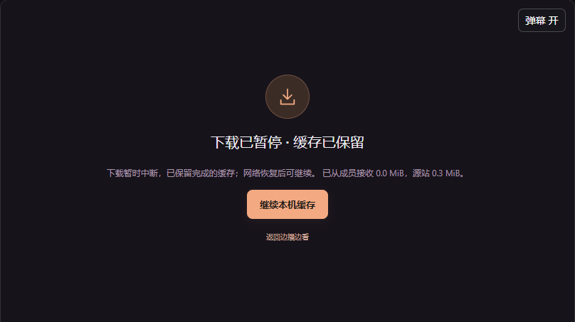

# 2026-10-31 缓存恢复与文件占用

**状态：源码实现、构建及隔离验收完成，尚未上线。** 用户反馈各种缓存方式都有中途重新缓存的问题，并明确正在观影、修复时先不重启。本轮没有部署 Pages / 房间 Worker、更新在线服务或操作正在观看的房间。

## 查到的路径

1. 房间 WebSocket 短断时，客户端主动调用 `stopCachedPlayback()`，取消下载并删除本机缓存。服务端重连时重置准备状态是必要的，但客户端把这一步错误地等同于删盘。
2. 下载遇到网络中断、超时或临时 HTTP 错误时，异常退出触发整个作业 `clear()`；重试按钮创建新作业，已完成分块被重新下载。
3. 缓存播放器出现网络读取 / 解码错误时，客户端直接清理缓存，并上报 0 字节。播放通道故障与本机文件失效没有分开处理。
4. `BrowserDiskCache.clear()` 先终止工作线程，再立即递归删除目录，没有等线程关闭同步文件句柄；逐段清理遇到占用则将缓存状态升级为 error。一个批次中部分文件已经删除、后续删除失败时，还会留下逻辑进度与真实磁盘不一致的风险。

使用真实 OPFS 同步文件句柄，两套隔离测试都复现出了与用户完全相同的错误：`NoModificationAllowedError`，消息为 `Failed to execute 'removeEntry' on 'FileSystemDirectoryHandle': An attempt was made to modify an object where modifications are not allowed.`。这条复现来自实际浏览器文件锁，不是改写原型或模拟异常。参考 [File System Standard 文件锁与删除](https://fs.spec.whatwg.org/#api-filesystemdirectoryhandle-removeentry)。失去目录写入授权属于另一类错误，处理方式单独保留。

## 修复

- 同标签页短断保留作业、落盘分块、播放器地址、内容指纹与本机 P2P 清单，只关闭失效的传输连接。重新认证并确认房间、服务器、媒体 ID 和缓存代次后，重新上报真实本机进度；服务端仍独占全员放行，断线期间不伪报在线或缓存就绪。房间结束、换片 / 换代、主动退出、会话被撤销仍执行清理。
- 临时网络错误自动尝试最多三次，之后暂停等待「继续本机缓存」，保留同一作业及已校验数据；没有后台无限重试。写入权限、占用及磁盘空间问题也保留已完成内容，必要的权限请求仅在用户主动继续时进行。
- 重复读取的旧分块先比较内容哈希，匹配才跳过写入和累计；不一致仍拒绝。源站不提供可靠 Range 时，会重新读取完整 HTTP 响应来核对已有块，保留磁盘进度和哈希状态；**不能称为网络字节断点续传，也不保证减少全部重传流量**。
- 播放错误保留作业，提供「重试本机播放」；已知缓存有效时重建本机读取通道，不重新下载视频。缓存已真正失效或作业已被取消时，不提供虚假的继续入口。
- 清理改为幂等操作：先让工作线程按队列关闭文件句柄，等待确认，再终止线程和删除目录；失效线程使用有界超时与短时占用重试。并发调用不重复删除同一目录，清理失败仍如实报告。
- 已看片段先撤销读取资格和 P2P 清单，再尝试物理删除。暂被占用的文件进入稍后清理队列；进度条仍将其标为已清理、不可跳回，实际保留字节仍包含尚未删掉的文件。播放推进时重试删除，不把占用变成整片缓存失效；结束清理仍核对真实删除结果。
- 新提示明确显示「下载已暂停 · 缓存已保留」或「播放暂时中断 · 缓存已保留」，区分继续下载、重试本机播放和需要重新准备。

## 验证

所有浏览器为独立无头 Edge、静音，使用 Node 隔离房间和 MDN CC0 / 本机合成视频，没有操作用户浏览器或实际网络连接。

- 构建及类型检查通过；20 项缓存、网络、代次、时间窗口、磁盘及恢复单元检查通过。恢复测试覆盖三次失败后停止自动重试、手动继续、并发等待的取消、无效内容不能冒充网络恢复。
- `test:disk-lifecycle`：真实同步文件句柄阻止删除时出现同一异常；三个并发 clear、快速创建 / 删除与初始化中取消均通过；另一作业仍可读到原字节 7，结束后目录为空、缓存 Web Lock 数为 0。
- `test:cache-window`：真实视频、两端 1/3 开播、首批真实落盘；两端 WebSocket 重连后目录、成员和指纹保持。真实文件锁阻止已看分块删除时，两端未进入错误状态，灰色区不可跳入；解除锁后文件实际删除。全片指纹、后台下载、看完清理通过。
- `VS_CACHE_PARTS=2 npm run test:cache-parts`：1/2 分批与完整缓存回归，断线后同作业继续；完整缓存注入 HTTP 503 三次，继续时保留 262,144 字节，已完成前缀只下载一次，作业目录不变，完成后两端全片指纹一致。
- `test:cache-parts`：1/3 非滑动缓存与完整模式；注入缓存读取错误后，「重试本机播放」成功解码，目录不变、源站前缀未重下。
- `VS_CACHE_NO_RANGE_HEADERS=1 npm run test:cache-parts`：不公开范围的源站顺序响应在写入前缀后真实断流，多次失败后保留 262,144 字节；重新读取响应、验证旧块后继续完成，两端指纹一致。播放通道重试不删盘。
- `test:session-refresh`：三次房主刷新、观众刷新、真实身份复用、新标签页独立身份、主动退出、失效房间和恢复时短断回归通过。

证据位于 `.local/disk-lifecycle-evidence.json`、`.local/cache-window-evidence.json`、`.local/cache-parts-2-evidence.json`、`.local/cache-parts-3-evidence.json`、`.local/cache-parts-3-sequential-evidence.json`，汇总见 [本轮隔离回执](cache-recovery-local.json)。测试脚本为 `scripts/cache-parts-check.ts`、`scripts/disk-lifecycle-check.ts` 和 `tests/cache-recovery.test.ts`，均可重复运行。

## 边界与发布安排

本次恢复保留的是**未刷新标签页内的有效作业**，并非跨刷新持久化下载恢复。刷新 / 关闭浏览器、换片、内容哈希不一致、明确取消或不可恢复的数据损坏仍需重新准备；不绕过登录、下载权限、DRM 或源站访问控制。

验证是桌面浏览器及隔离双端，不声称 Android / iPhone 真机或所有原站实播验收。Windows / Android 已发布安装包没有更新；共享前端源码改动将在之后单独打包时进入客户端。

按用户当前观影安排，正式网页仍是本轮开始前的版本。后续统一更新应沿用既有免费账号与房间服务，不需为本修复重启房间 Worker；部署时仍需重新核对入口和资源哈希。本轮没有新建预览站点、安装包或额外回退副本。
