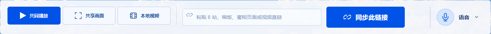

# 2026-11-01 天光控件统一

用户反馈天光断层不同区域的按钮不一致，并要求去掉主题选择中“Glitch Art”和“C · 反相故障”。原有同步按钮使用单独的切角底板，邀请按钮有独立的 ID 样式，播放选项、弹窗与其他按钮又各自设置圆角和颜色。

新增 `client/daylight-controls.css` 作为天光控件统一入口：圆角 6 px，主按钮及选中项使用同一蓝色和白字，次按钮使用相同浅色底 / 描边，轻操作使用透明底及同一蓝色文字。统一悬停、键盘焦点、禁用状态；保留主次操作、图标与切换控件的尺寸层级。移除同步按钮的专用切角底板和邀请按钮的独立描边，断层绘制读取真实控件圆角。播放器深色控制层继续保留可读的浅色图标，开关、语音状态与减少动态效果设置保留。

主题选项和入口的可访问名称分别为“天光断层”“紫电噪讯”，不再包含英文副标题或 C 设计代号；暖夜的“原版”提示保留。

## 验证

- 构建和类型检查通过；`test:daylight-controls` 在独立静音 Edge / 独立房间检查四个区域，共 66 次控件样式观察，确认主按钮及选中项蓝色、次 / 轻操作颜色、6 px 圆角、悬停及键盘焦点；核对两个主题副标题确实从 DOM 删除。1536、850、390、320 px 无横向溢出，未提交媒体、缓存、模式或播放控制操作。
- `test:appearance` 完整回归通过：真实合成双端视频持续播放、切换主题不重载播放器、语音接收保持、聊天及侧栏收起恢复；随机分配与本机记忆、窄屏、缩放、全屏、强制配色与减少动态效果通过。
- 原有 50% 悬停触发、重入随机变化、文字 / 图标同源断层、多个按钮的动态条片、背景取样和视频保护通过。视频像素保护、输入框保护及真实控件边界稳定都有断言；没有为样式统一新增持续闪烁或复制媒体。
- 当前助手 ZIP 仍为 0.1.2，SHA-256 `5179bd726d9b9565605f2705448e6346d46210a2f642f251e69ed28f5bf5f84c`；未更新客户端安装包或触发发布工作流。测试截图更新现有 README 插图，只保留当前构建和既有唯一回退。

重复入口为 `npm run test:daylight-controls` 和 `npm run test:appearance`，经受控入口串行执行。原始记录为 `.local/daylight-controls-local-evidence.json` 与 `.local/appearance-evidence.json`；桌面浏览器响应式检查不称为手机真机验证。发布回执另记录正式入口哈希与健康检查；不操作用户观影房间或主动刷新页面，不更新房间后端。
