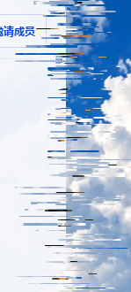

# 2026-10-31 天光断层：精细原色与反色对冲

按用户提供的两张局部对照图，细化容器边缘的断层。使用细密、疏密不齐的照片片段与对应反色，保留边缘轮廓和内容保护。

截图来自应用实际渲染、MDN CC0 样片的隔离房间，不是概念图。只截取聊天室的边缘，实际视频仍在原播放器中。

## 实现

- 从当前同源天空与本应用表面颜色生成有界双幅样本，一侧保存原色，一侧逐 RGB 通道计算 255−原值，透明度保持。参考 [MDN Canvas 像素反色](https://developer.mozilla.org/en-US/docs/Web/API/Canvas_API/Tutorial/Pixel_manipulation_with_canvas#grayscaling_and_inverting_colors)。
- 边缘素材保留最高 1.5 倍像素采样，稀疏扫描行按亮度排序。主切片通常为 1–3 CSS 像素，少量 5 像素碎包；长短、间隙与分组不同，按原有离散节拍变换。部分照片行跨组重排，原色与少量反色片段反向位移。
- 让照片碎片进入浅色边缘，浅色片段移向照片侧，形成交错断口。反色作为短小对冲片段，保留蓝白主色和清楚的轮廓。向内绘制限制在外侧 16% 范围，视频、输入、聊天正文及打开的业务弹层继续使用完整保护。
- 每次交互仍约 840 ms，无活动时停止绘制。原色 / 反色合并到同一短时样本内，沿用每次交互最多 4 个样本、最多 8 次交互的上限；未引入新依赖、常驻渲染循环或媒体像素采样。

## 本地验收

受控串行执行 npm run build、npm run test:appearance，通过。验证包括真实双端房间、CC0 视频、主题切换后的播放器与语音收听状态保持、聊天、按钮动效与点击边界、收起 / 展开、窄屏 / 缩放、两种全屏、减少动态效果与静止后的画布清空。

增加实际颜色反演检查：将主题照片临时换为测试色 RGB(245,160,24)，渲染层中同时检测到 4437 个原色像素及 138 个 RGB(10,95,231) 反色像素，容差为每通道 1。测试后恢复原照片；没有修改或读取影片像素，也没有操作用户正在观看的房间或麦克风。数值为此轮采样，不固定故障纹理。

本地证据 `.local/appearance-evidence.json`，真实局部截图 `.local/screenshots/daylight-fine-edge.png`。正式部署结果完成后补充。
