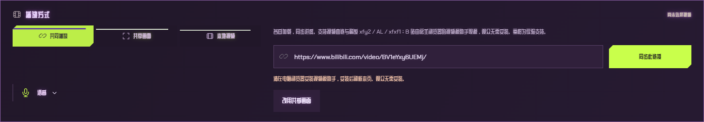

# 2026-11-01 播放方式按钮高度

用户截图中紫电主题的共同播放 / 共享画面 / 本地视频选项被拉得很高。隔离房间复现：1556 px 宽度下，正常选项高度约 47.59 px，右侧出现 B 站助手错误和安装入口后变为 87.83 px。

原因是紫电主题将左侧选项和右侧播放输入放在同一个网格中，右侧跨两行并随错误提示增高，左侧网格项目默认拉伸，再把高度分给三个按钮。天光布局和原版按钮样式共用 `.playback-tabs`，修复直接在共用选项组设置 `align-self: start`，让其使用内容高度，不再跟随邻居拉伸。没有固定最大高度或隐藏文字，也不改变已有字体、故障效果和媒体状态。布局原则参考 [CSS Box Alignment 的网格自对齐](https://www.w3.org/TR/css-align-3/#align-self-property)。

可重复入口为 `npm run test:playback-tabs`，通过 `scripts/controlled.ps1` 串行运行。独立无头 Edge / 独立验收房间，三套主题分别在 320、390、600、850、1160、1200、1556、1920 px 宽度检查正常、真实助手缺失错误、三种面板切换，核对文字位于按钮内、按钮高度稳定、页面无横向溢出，且没有发出媒体、控制、缓存或模式更换操作。仅验证桌面浏览器响应式布局，不称为手机真机验证。

构建、类型检查和上述 24 组隔离布局检查通过。1556 px 紫电主题下，修正后正常、错误提示、共享画面、本地视频和共同播放均为 44 px。原始记录为 `.local/playback-tabs-baseline-evidence.json` 与 `.local/playback-tabs-local-evidence.json`。

部署和实际检查结果见对应回执。更新仅涉及网页样式；不更新房间 Worker，不主动刷新现有用户页面。当前构建和已有唯一回退保留，没有新增历史构建副本或客户端安装包。
