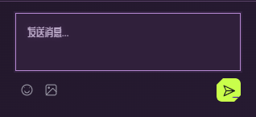
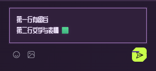

# 2026-10-31 紫电全界面字体与输入框

按用户反馈，将此前只用于品牌与少量标题的主题字体扩展到紫电全界面，沿用用户认可的霓虹管芯和光晕，同时修正聊天输入贴边、链接图标与文字未居中的问题。

## 实现

- 紫电根字体改为 Chakra Petch + ZCOOL QingKe HuangYou，覆盖按钮、昵称、聊天、成员、语音 / 缓存菜单、设置及播放数字。英文增加 400 正文字重，保留 600 强调字重。Emoji 使用系统彩色字体，不支持的字符保留系统回退。
- 中文不再限定为几十个固定标题字，而是随站提供上游字体的 Unicode 文本分片；根据实际显示文字加载。字体资源共 94 个 WOFF2、3,056,852 字节，不要求每个页面全部下载。许可、原文件和 SHA-256 保留，下载维护脚本不进入运行时或构建流程，不向字体服务上传聊天和昵称。实现依据 [MDN unicode-range](https://developer.mozilla.org/en-US/docs/Web/CSS/Reference/At-rules/@font-face/unicode-range)。
- 标题采用原有强管芯与紫粉双层光晕，菜单、成员与操作文字使用较窄光晕，正文与输入使用轻微辉光；亮酸绿按钮保留深色文字，播放数字不增加模糊光晕。几处小字调至 12px，聊天正文和输入为 14px。光晕稳定显示，不增加闪烁循环；强制颜色模式关闭光晕。
- 聊天输入框上下 12px、左右 14px 内边距，22px 行高和至少 72px 外框，双行文字可完整显示。占位提示与实际输入使用相同留白。
- 链接图标在与实际输入框同高的装饰区域内使用 Flex 居中，桌面 48px、窄屏 45px；SVG 为 block，图标与文字起点间留 12px。窄屏按钮换行后，图标仍按输入框高度定位，不按整个表单居中；图标不截获点击。

## 隔离验收

受控串行执行 `npm run build`、`npm run test:signal-theme` 与原主题 `npm run test:appearance` 回归。最后一次调大紫电小字后，重新构建并运行完整 signal 检查，通过。所有测试使用独立房间、隔离无头 Edge 和静音的 MDN CC0 视频，没有刷新或操作用户正在观看的房间。

- 检查品牌、标题、聊天、播放栏、按钮、两个输入框、成员、设置、缓存的实际样式；确认均使用对应主题字体，所有字体请求为同源。
- 不仅检查 CSS 声明，还通过 [Chrome DevTools Protocol getPlatformFontsForNode](https://chromedevtools.github.io/devtools-protocol/tot/CSS/#method-getPlatformFontsForNode) 检查真实聊天字形提供者：站酷庆科黄油体 12 个字形、Chakra Petch 2 个字形、系统 Segoe UI Emoji 1 个字形。
- 桌面和 320 / 390 CSS 像素窄屏：聊天内边距均为 12 / 14 / 12 / 14px，可容纳两行；链接图标中心偏差为 0px，与文字起点间距为 12px，点击图标位置仍命中输入框。双行文字和 Emoji 输入、清空后占位提示均检查并目视截图。
- 双端真实聊天、Emoji、播放和暂停传递通过；切换主题保持视频 / 音频 / 语音对象，不发送额外房间媒体或控制消息。语音仅加入收听，麦克风申请为 0。
- 背景仍只响应按钮激活，局部悬停仍按每次进入约 50% 判断；收起 / 展开、弹层、网页与系统全屏、窄屏、减少动态效果和强制颜色模式通过。31 帧视频比对最大通道差异为 0。

窄屏是桌面浏览器视口验收，不声称手机真机测试。可重复入口为 `scripts/signal-theme-check.ts`；本地证据位于 `.local/signal-theme-evidence.json`、`.local/appearance-evidence.json`。

## 发布

本地验收后集中更新同一正式 Pages，不新增预览站点、不部署房间 Worker 或客户端安装包。部署与线上核验回执在本轮发布后补充。
