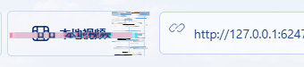

# 2026-10-31 随机悬停、断层收尾与紫电字体

本轮同时处理天光按钮右侧断层的直边裁断、悬停必定触发的机械感，以及紫电主题的霓虹文字与字体。

## 实现

- 天光不再先画出长切片、再仅依赖输入框的矩形擦除。绘制每条切片前检查相邻输入、视频和弹层，按不同余量缩短尾部；偏移后的文字条与 RGB 边也预留保护距离。最终视频 / 输入保护仍保留，控件真实位置与点击范围不变。
- 天光与紫电共用每次进入区域的随机判断：`Math.random() < 0.5`；同一次进入保持该结果，移动不重新抽签。再次进入可重新触发。位移幅度为基准的 70%–130%，片段大小为 80%–120%，沿用离散节拍与短时收尾，不增加静止时的动画循环。
- 紫电背景继续只在页面按钮激活时短暂闪动，覆盖原生按钮和有按钮语义的控件，支持键盘激活；局部悬停的概率不改变此规则。全屏、减少动态效果及有限冷却保持。
- 紫电品牌使用 Chakra Petch，聊天室等固定中文标题使用站酷庆科黄油体，增加亮色管芯和两层柔和紫粉光晕；房间名轻量提亮，聊天正文、输入及播放数字保持系统字体和可读性。没有新增文字闪烁循环，强制颜色模式关闭光晕。
- 字体为 OFL-1.1、同源静态 WOFF2 文件，固定版本来源及 SHA-256 见 `client/assets/fonts/SOURCES.json`，完整许可随网页分发。CSS 限定固定中文标题的 Unicode 范围，浏览器按需加载；不依赖用户可达外部字体网站，不发送用户文字到字体服务。

## 隔离验证

受控入口串行执行 `npm run build`、`npm run test:appearance`、`npm run test:signal-theme`。两套浏览器验收均已通过，执行于独立房间和独立的无头 Edge，未刷新或操作用户正在观看的房间。

- 真正进入按钮后，用测试专用的固定随机数覆盖拒绝与接受两条路径：0.5 不触发，停留区域内改随机数仍不触发；离开后重新进入可触发。紫电两次进入实际记录的幅度 / 大小分别为 0.76 / 0.84 与 0.97 / 0.98。生产代码未固定随机数。
- 天光本地视频按钮右侧局部实测 455 个装饰像素，尾部有 9 个不同的终点列；输入框内部装饰像素为 0。对七类实际按钮验证动画存在、按钮位置不变，视频 / 输入保护通过。计数随采样时刻改变，不作为固定纹理。
- 两款新字体实际加载并检查同源资源请求；品牌、标题光晕生效，聊天正文和控制栏光晕为 none。
- 独立双端实际播放 MDN CC0 视频、聊天和 Emoji 传递通过；主题切换不重建视频 / 音频 / 语音对象，不产生换片或房间控制。语音仅加入收听，麦克风申请为 0。
- 同时激活动效，冻结已解码视频并每 30 ms 检查一次，共 31 帧，视频画面最大通道差异为 0；装饰不覆盖影片。
- 窄屏 320 / 390 CSS 像素、主题记忆、聊天室收起 / 展开、语音与成员弹层、网页与系统全屏及减少动态效果回归通过。窄屏为隔离桌面浏览器视口，不声称手机真机验收。

已目视检查天光按钮局部及紫电完整放映厅截图。可重复入口为两套上述浏览器脚本，运行证据分别在 `.local/appearance-evidence.json` 与 `.local/signal-theme-evidence.json`。

## 部署

源码 `3aa18ec` 已集中更新原正式 Pages 一次，部署 `418855be`，入口为[正式网页版](https://videosreeeen.pages.dev)。没有创建预览站点、部署房间 Worker、更新安装包或刷新用户的房间。

正式入口另建独立双端房间运行两套相同检查，均通过并干净退出。随机拒绝 / 接受、霓虹与同源字体、布局、聊天、语音收听、全屏及视频保护均通过。天光按钮右侧本次采样为 244 个像素、9 种终点列，输入框内为 0；紫电视频比对 31 帧最大通道差异为 0。

线上 HTML 与全部 21 项静态资源逐一核对 SHA-256，均与本地构建一致；`/healthz` 确认原房间绑定健康。[部署与验证回执](theme-interaction-deployment.json)记录源码提交、全部资源哈希、字体实载检查和两套验收结果。入口为 `assets/index-Dn7heQsQ.js`，样式为 `assets/index-CRWp1pPP.css`，助手 ZIP 的 SHA-256 保持 `4c94b6e9c51934513326402fd1d34a21d42da72f3a3052349113f85b38a13307`。

当前 Web 产物约 3.58 MiB，Pages 上传目录原位覆盖同一当前版本，没有新建历史归档、APK 或桌面包。唯一既有回退定位仍为 `.local/rollback/manifest.json`，没有增加回退副本；D 盘可用约 49.75 GiB。保留字体源码与许可、原始素材和既有用户配置。
